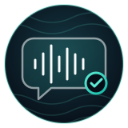

<p align="center">
  
</p>

<h1 align="center">truth-in-stream</h1>

<p align="center">
  <strong>Real-time fact-checking for live streams.</strong><br>
  Transcribe the broadcast, retrieve the evidence, verify the claim, and surface the verdict
  while the speaker is still talking.
</p>

<p align="center">
  <a href="#quick-start">Quick start</a> &middot;
  <a href="#how-it-works">How it works</a> &middot;
  <a href="#surfaces">Surfaces</a> &middot;
  <a href="#tech-stack">Tech stack</a> &middot;
  <a href="#documentation">Documentation</a>
</p>

<p align="center">
  
  
  
  
  
  
</p>

---

Live debates, broadcasts and streams move faster than anyone can fact-check by hand. By the time a
claim is checked, the conversation has moved on. **truth-in-stream** closes that gap: it listens to a
live stream, pulls out the checkable claims as they are spoken, finds supporting or contradicting
evidence, and streams an evidence-grounded verdict back to the viewer in near real time.

Verdicts are **derived from retrieved evidence by an LLM verifier** rather than borrowed by
similarity, so a match is a reason, not a coincidence. The same retrieve-then-verify pipeline serves
live streams, imported videos, uploaded PDF documents and live television channels.

The app runs in production at **<https://jeminforme.fr>**, behind Keycloak login, on AWS. The steps
below bring up the whole stack locally as a fully offline demo.

## Quick start

**Prerequisites:** Docker Engine 24.0+ with the Compose v2 plugin (`docker compose version`), GNU
make, the Go toolchain for `make bootstrap`, and a few GB of free disk. No API key is needed: the
local dataset (curated claims, a Wikipedia evidence subset, demo-video results) seeds fully offline
from a committed embedding cache.

```bash
git clone https://github.com/verovec/truth-in-stream.git && cd truth-in-stream
make doctor      # optional: preflight Docker, Compose v2, make, and the daemon
make bootstrap   # generate .env: operator email, argon2id password hash, session secret
make up          # build and start the whole stack
```

`make up` runs, in order: Postgres, a one-shot `migrate`, a one-shot offline `seed`, a local Keycloak
importing a prepopulated realm, then the backend and frontend. Open <http://localhost:3000> and sign
in through Keycloak with a local dev user (`admin` / `test1234` or `guest` / `guest`); `admin`
additionally reaches the [backoffice](docs/backoffice.md) and sees the debug toggle. The backend
health check is at <http://localhost:8080/healthz> and the Keycloak admin console at
<http://localhost:8081>. The bundled demo clip plays with the fact-check panel populated from seeded
results, with no provider call. To move on to live analysis, add real API keys; see
[Configuration](docs/configuration.md).

## How it works

A live stream (or an imported video) flows through a single streaming pipeline:

```
  Live audio
     |
     v
  Speech-to-text          AssemblyAI Universal-3 Pro, diarized realtime WebSocket
     |
     v
  Claim detection         pull check-worthy statements out of the transcript
     |
     v
  Semantic retrieval      Voyage embeddings -> pgvector search over a curated
     |                    claim corpus + Wikipedia evidence
     v
  LLM verification        a verifier derives a verdict from the retrieved evidence
     |
     v
  Verdict, streamed       shown in the fact-check panel, synced to playback
```

Live streams and imported videos use the **same** path: there is no separate batch transcription
route. The verification store can be seeded with curated claims or backed by a full Wikipedia
evidence corpus built by an opt-in ingestion fleet (see
[the ingestion pipeline](docs/ingestion-pipeline.md)). Once an imported or uploaded video finishes,
its analysis is cached, so reopening it replays the full transcript and verdicts instantly with no
re-transcription or LLM calls; a cache miss falls through to the live pipeline unchanged (see
[the analysis cache](docs/configuration.md#analysis-cache-instant-replay)). The components and the
data flow are detailed in [Architecture](docs/architecture.md).

## Surfaces

Watching and reading stay open to every authenticated user; content ingestion is an operator task,
gathered in an admin-only backoffice.

| Route | Who | What | Details |
|-------|-----|------|---------|
| `/app` | every authenticated user | The video library: live streams and imported videos with the fact-check panel synced to playback | [Configuration](docs/configuration.md) |
| `/documents` | every authenticated user | Uploaded PDFs (press articles, reports, official publications) read with credible and disputed sentences highlighted in place | [PDF fact-check](docs/pdf-fact-check.md) |
| `/tv` | every authenticated user | Free, non-DRM channels (official 24/7 YouTube news simulcasts and parliamentary video portals) captured server-side: the official embed beside live verdicts, plus the channel's hour-chunked recordings when archiving is on | [Live TV capture](docs/tv-live.md) |
| `/backoffice` | `admin` role only | Upload videos and YouTube links, upload documents for a one-time analysis, curate the library, turn TV channels on and off | [Backoffice](docs/backoffice.md) |

## Tech stack

| Layer | Tech | Location |
|-------|------|----------|
| Frontend | Next.js 16 (App Router, React 19, TypeScript, Tailwind v4) | `stack/frontend` |
| Backend | Go (standard-library `net/http` service) | `stack/backend` |
| Data | Postgres 16 + `pgvector`, Voyage AI `voyage-4-large` embeddings (1024-dim `halfvec`, HNSW cosine) | `stack/backend` |
| Speech-to-text | AssemblyAI Universal-3 Pro streaming (the single transcriber) | `stack/backend/internal/transcribe` |
| Auth | Keycloak OIDC with `admin`/`guest` roles; the `/api` subtree and live WebSocket are gated on the verified identity | `stack/keycloak` |
| Infra | Terraform on AWS (`eu-west-3`): CloudFront + WAF over an internal ALB, RDS Postgres 17 + `pgvector`, live at [jeminforme.fr](https://jeminforme.fr) | `stack/terraform` |

The Go backend is layered `cmd/server` (wiring) -> `internal/handler` (HTTP) -> `internal/service`
(logic) -> `internal/store` (data). The frontend defaults to Server Components and is responsive
across mobile and desktop. In production, structured logs ship to CloudWatch and alarms fan out to
Slack; see [Infrastructure -> Observability](docs/infrastructure.md#observability).

## Documentation

| Topic | Where |
|-------|-------|
| Layers, pipeline, surfaces, data, local services, configuration | [`docs/architecture.md`](docs/architecture.md) |
| Tests, CI, and the Claude delivery workflow | [`docs/development.md`](docs/development.md) |
| Configuration, auth secrets, local seeded data | [`docs/configuration.md`](docs/configuration.md) |
| First production setup (AWS bootstrap through first ingested data) | [`docs/first-setup.md`](docs/first-setup.md) |
| Infrastructure and operations (AWS edge, deploy, backups, observability) | [`docs/infrastructure.md`](docs/infrastructure.md) |
| Ingestion pipeline (local + cloud, diagrams, consistency) | [`docs/ingestion-pipeline.md`](docs/ingestion-pipeline.md) |
| Fact-check evidence sources | [`docs/fact-check-sources.md`](docs/fact-check-sources.md) |
| Always-on rules and engineering standards | [`CLAUDE.md`](CLAUDE.md) |
| Everything else | [`docs/`](docs/README.md) |

## Contributing

This repository is delivered card by card from Linear, with an automated CI gate and a mandatory
code-review step on every change. The engineering standards (best-practice first, tests with every
behaviour change, layered architecture, no secrets in code) are in [`CLAUDE.md`](CLAUDE.md), and the
day-to-day workflow and slash commands are documented in
[`docs/development.md`](docs/development.md#claude-workflow).
